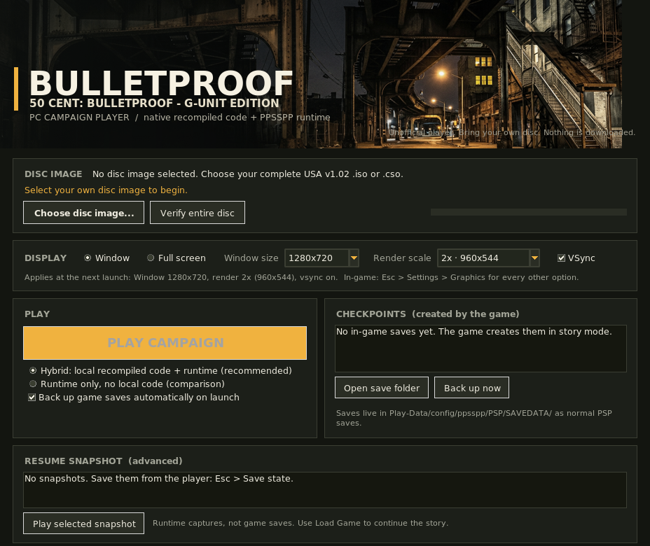

# Bulletproof • PC Campaign Player

An offline, unofficial x86-64 **campaign launcher and player** for **50 Cent: Bulletproof – G-Unit Edition (USA), ULUS10128 v1.02**. It plays the game's own story mode from your own disc image, with a launcher that remembers your disc, verifies the complete image, lists your checkpoints, keeps save backups and can resume a runtime snapshot.

This is a **hybrid static recompilation**: the kit compiles part of the game engine from *your* disc on *your* PC, and a modified PPSSPP 1.20.4 runtime supplies the rest (remaining instructions, threads, graphics, sound, input, files, saves). It is not an emulator-free conversion of the whole game, and it is not a shortcut to a stock emulator launch. **No game data, save file or pre-compiled game module is included** — the disc image and every save are yours.

## This repository

This is the **source repository**. It holds the launcher, the host-side recompilation glue, the disc reader, the rebuild scripts, the guides and the tests. Game data, saves, generated native modules and the prebuilt player are not in git — the distributable kit is attached to [Releases](../../releases) and built with `rebuild/package.py`. See [docs/REPOSITORY.md](docs/REPOSITORY.md) for the exact layout and boundaries.



```sh
git clone https://github.com/OWNER/bulletproof-pc.git
cd bulletproof-pc
python3 scripts/check_source_only.py    # the tree contains no game data or generated binaries
python3 tests/test_disc.py && python3 tests/test_launcher.py && python3 tests/test_campaign.py
```

To create the GitHub repository from a local copy, see [scripts/push-to-github.sh](scripts/push-to-github.sh) (needs the `gh` CLI) or the manual `git remote add` + `git push` command in that file's header.

## Requirements

- **Windows x64:** nothing besides the kit. Bundled Python, the `allegrexrecomp` compiler and the C compiler are inside the ZIP. Windows testing was done under Wine 10; it has not been checked on a physical Windows machine.
- **Linux x64:** Python 3.11+ with Tk (for the launcher), a C compiler (`tcc` + GNU `ld` is fastest, `cc` works), a desktop OpenGL driver and sound. Built and played on **Debian 13**. On Debian/Ubuntu:
  ```sh
  sudo apt install python3 python3-tk tcc binutils libsdl2-2.0-0 libsdl2-ttf-2.0-0 \
    libglew2.2 libzip5 libminiupnpc18 libsnappy1v5 libzstd1 libfontconfig1 \
    libpng16-16t64 libopengl0 libgl1
  ```
- Your own complete USA v1.02 disc image (`.iso`, or a CISO v1 `.cso`) of **ULUS10128**. Other regions, revisions, trimmed/“cleaned” images and archives are rejected.
- About 300 MB free space for the kit plus its local build cache. The kit folder and `Play-Data/` must be writable. Your disc is opened **read-only** and never modified.

## Start

**Windows:** extract the whole ZIP to a normal writable folder (for example `C:\Games\Bulletproof PC`), then open **Play Bulletproof.exe**. The campaign launcher opens. You can also drop a disc image onto the EXE to play that image directly.

**Linux:** extract the whole ZIP to a writable, executable filesystem and run, from the kit folder:

```sh
sh './Play on Linux.sh'            # campaign launcher
sh './Play on Linux.sh' '/path/to/your/disc.cso'   # skip the launcher, play this image
```

## The launcher

1. **Choose disc image…** Pick your own `.iso`/`.cso`. The launcher reads the disc ID, revision and boot program, then offers to **verify every sector** of the image (read-only; a few minutes for a full 1.6 GB image). When that passes, the launcher says *Complete disc verified* and remembers the image, so later launches start instantly. If you replace or edit the file, it asks to verify again.
2. **PLAY CAMPAIGN** starts the player. On the very first run the kit generates and compiles the local native module (a short wait, with a progress window); later runs reuse it. Saves, settings and logs stay in `Play-Data/`.
3. **Checkpoints** lists the in-game saves the game itself has written, newest first, with the game's own description (for example *Industrial District* or *Endgame*). Use it to see where you are; continue the story with **Load Game** inside the game.
4. **Back up now** copies your saves into `Play-Data/Backups/` as a timestamped ZIP. Automatic backup before each launch is on by default and skips making duplicates.
5. **Resume snapshot** (advanced) lists PPSSPP save states you made yourself in the player (**Esc → Save state**). These are exact runtime captures, not in-game saves; they are useful to demo a specific late level, and they break if the game's data changes.
6. **Hybrid** (the default) uses the locally recompiled engine code plus the runtime; **Runtime only, no local code** disables the local code for comparison.

### Display and resolution

The launcher's **DISPLAY** row is applied at the next launch, and the player's own `Esc → Settings → Graphics/Window` still works for everything else:

| Control | Options | Notes |
|---|---|---|
| Window / Full screen | Window, Full screen | Full screen uses your desktop resolution; window size is ignored. |
| Window size | 960×544, 1280×720, 1366×768, 1600×900, 1920×1080, 2560×1440, 3840×2160 | Window mode only. The 16:9 window is a good fit for the PSP's 480×272 frame plus HUD. |
| Render scale | Runtime default, 1× · 480×272, 2× · 960×544, 3× · 1440×816, 4× · 1920×1088, 5× · 2400×1360 | 1× is the native PSP resolution (sharp, fastest); 2× is the default. Higher scales supersample the 3D scene. |
| VSync | on / off | Off suits fast-moving displays; on avoids tearing. |

These map to the runtime's own persistent settings (`FullScreen`, `WindowWidth`, `WindowHeight`, `InternalResolution`, `VSyncInterval`), so a launch from the launcher and a launch from the command line agree. For a run-only override:

```sh
python3 play.py '/path/to/disc.cso' --display-mode fullscreen
python3 play.py '/path/to/disc.cso' --windowed --width 1920 --height 1080 --render 3 --no-vsync
```

`--render` accepts `auto`, `1`…`5`. Aspect ratio, texture filtering, frameskip, shaders and every other graphics option live in the in-game `Esc → Settings` menu.

## Playing

1. Click the game window. Press **Z** at the autosave notice, let the logos play, press **Space** at the title.
2. **New Game** → difficulty. *Play Tutorial* opens the Theater; *Skip Tutorial* starts the **Industrial District** story mission.
3. Pick a slot with **Z**, wait for **Save completed**, go back with **X**. Dismiss game messages with **Z**.
4. Move with **I / J / K / L**. **Space** is the in-game pause/phone menu. **Esc** is the PC runtime menu (mapping, settings, exit).
5. To continue later: launcher → **PLAY CAMPAIGN** → **Load Game** → slot → **X** after *Load completed* → **Resume Game**. Don't close the game while a save is being written.

| PC | PSP input |
|---|---|
| I / K / J / L | Analog up / down / left / right (movement) |
| Arrow keys | D-pad / menus |
| Z / X | Cross (accept) / Circle (back) |
| A / S | Square / Triangle |
| Q / W | L / R shoulder |
| Space / V | Start (game pause) / Select |
| Esc | PC runtime menu (not the in-game pause) |

Remap keys or a gamepad in **Esc → Settings → Controls → Control mapping**. A physical controller was not part of the testing.

Saves are ordinary PSP saves in `Play-Data/config/ppsspp/PSP/SAVEDATA/ULUS101280000/` (a 12,356-byte `KEVLAR.BIN` plus the save's metadata and preview art). They are independent of the native cache, so `--rebuild` keeps your progress.

## Not an emulator-free port

The kit compiles the engine's code on your PC; the PSP runtime is still there for the remaining instructions and for graphics, audio, input, files and saves. **Hybrid, not standalone.** [guide/UPSTREAM.md](guide/UPSTREAM.md) lists precisely what an emulator-free build of this title would need (full-code emission including VFPU and the six support modules, a Geometry Engine renderer, kernel services, codecs, timing) and where the early standalone attempt actually stopped. `--compat` and the session counters let you see the difference instead of taking it on faith.

## About “the full game”

The launcher verifies that the **whole disc** — all 823,360 sectors, 869 files, 1,686,241,280 logical bytes — matches the USA v1.02 image, so every level, movie, audio bank and data file on the disc is present and identical to the original. The complete PS2-derived story campaign is on that disc and is what this player boots; nothing is cut, unlocked, stubbed or replaced. See [guide/CAMPAIGN.md](guide/CAMPAIGN.md) for exactly which parts have been observed running, and for an honest account of what has not been shown.

## What is native?

`andyst-dev/psprecomp` emits C from your disc on your machine. This kit compiles **659 complete routines + 11,021 straight-line instruction sequences = 84,768 of the 199,087 instruction positions** in the engine's `.text` (**42.58% static selection** — not “42.58% of play time”). At boot, 11,679 of 11,680 entries install with exactly matching instruction words; the last one stays on the normal host path. The PPSSPP host runs everything else. Play evidence and end-of-session counters are in [guide/PLAYTEST.md](guide/PLAYTEST.md).

## Command line (optional)

Linux examples; on Windows use `vendor\python-win64\python.exe -B play.py`.

```sh
python3 play.py                              # remembered disc, launcher settings
python3 play.py '/path/to/disc.cso'          # a specific image
python3 play.py --verify-full '/path/to/disc.cso'   # verify every sector, then remember it
python3 play.py --build-only                # verify + compile, don't start the game
python3 play.py --audit                     # compare each entry's first live call with the interpreter
python3 play.py --rebuild                   # regenerate native code, keep saves
python3 play.py --compat                    # emulation-only comparison
python3 play.py --state 'Play-Data/config/ppsspp/PSP/PPSSPP_STATE/ULUS10128_1.02_0.ppst'
python3 play.py --fullscreen --no-backup --data '/path/to/my-data'
python3 play.py --windowed --width 1600 --height 900 --render 5 --no-vsync
python3 tools/verify_files.py               # check the kit's own files; ignores your data
```

`Play-Data/native/<platform>/` holds the local module, its receipt and the emitter/compiler logs. `Play-Data/logs/session-*.txt` records native calls, distinct entries, audit results and display counters. A `stop` line with `calls=` above zero confirms the local code really ran. One player per kit folder at a time.

## Troubleshooting

- **Disc rejected:** use an unmodified complete USA 1.02 image (raw ISO or CISO v1). Expected boot SHA-256: `3db80280dbfcac7bba87160c00e7bcc94686a96e804d00cdd4ad6cbcd0ca5fc8`. A filename change does not change a revision. Emulators' savestates, ISOs with the plain `BOOT.BIN` removed and “CSO re-packed by a different tool” images can all fail verification.
- **“The image changed since verification”:** the file was replaced, moved or touched by a sync tool. Verify again; your saves are unaffected.
- **Nothing opens / compilation failed:** extract the entire ZIP (not running from inside it), avoid Program Files, prefer a short path, and read `Play-Data/native/<platform>/compile.txt`. `--rebuild` regenerates the module without touching saves.
- **Linux missing library or `GLIBC_*` / `GLIBCXX_*` error:** `ldd runtime/PPSSPPSDL` lists unresolved libraries. The supplied binary needs up to `GLIBC_2.38` / `GLIBCXX_3.4.32`, `libminiupnpc.so.18`, `libzip.so.5`, `libGLEW.so.2.2` and SDL2; install matching packages or [build the host for your distro](rebuild/BUILDING.md). Don't symlink incompatible versions. This is not an AppImage.
- **Black screen after the legal text:** short transitions are normal. Keep the disc file available. This build uses PPSSPP's matched static FFmpeg; unrelated system FFmpeg builds were seen to hang during movies. Try another renderer or 1× resolution in the runtime settings, and restart.
- **No input or sound:** focus the game window; arrows are the D-pad, movement is I/J/K/L; check the output device and close other player instances. On Linux, `SDL_AUDIODRIVER` can be set to a driver that fits your system.
- **Saves seem missing:** the same kit folder with the launcher keeps one memory stick in `Play-Data/`; a different `--data` folder is a different stick. Restore a backup ZIP's `ULUS101280000/` folder into `Play-Data/config/ppsspp/PSP/SAVEDATA/` if needed.

## Contributing, tests and licensing

- [CONTRIBUTING.md](CONTRIBUTING.md): ground rules (no game data, no overclaiming), how to run the synthetic tests, what a good PR includes.
- `scripts/check_source_only.py` and `scripts/check_docs.py` run in CI: they fail if a commit would carry game data, a generated module or a broken local doc link, or if any sentence presents this hybrid as emulator-free without denying it.
- `.github/workflows/ci.yml` runs the unit suites on Linux, Windows and macOS with Python 3.11–3.13.

Not affiliated with the game's publishers, artists, Sony or the PPSSPP team. See [THIRD-PARTY.md](THIRD-PARTY.md) for licenses and [rebuild/BUILDING.md](rebuild/BUILDING.md) for how everything is built.
